# Accel Business · Udyam Digital

A phone-first journey that takes a small business owner from "what do I need?" to "my order is being installed" in one sitting, in their own language, with **everything running locally** (local LLM, local OCR, no cloud AI).

▶ **Demo video (3 min):** <https://vimeo.com/1244849273>

[](https://vimeo.com/1244849273)

**Journey:** language → AI advisor chat (asks what troubles the business, pack builds live on screen) → a plan that sells honestly (3 packs, "you told us, here's the fix", pack vs buying separately, online sign-up offers) → consent + Smart KYC → e-sign → order tracker. Plus a back-office view for sales and partners. No phone number or OTP is asked.

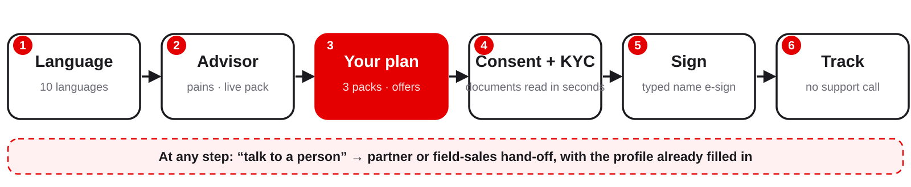

<p align="center">
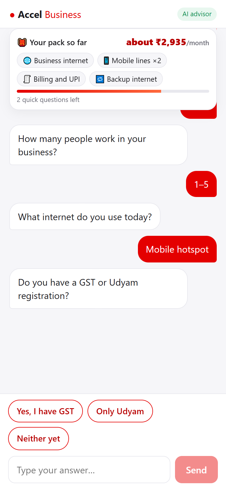
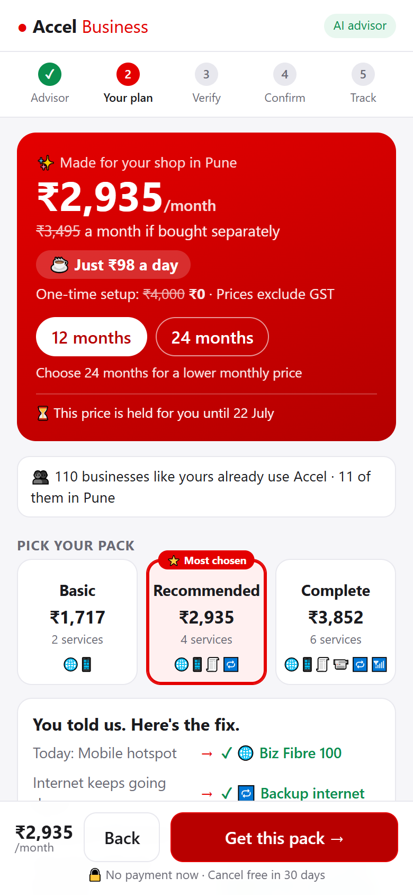
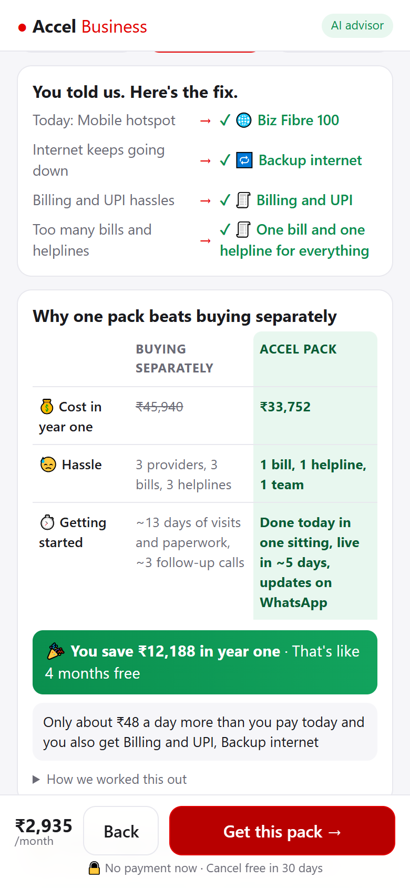
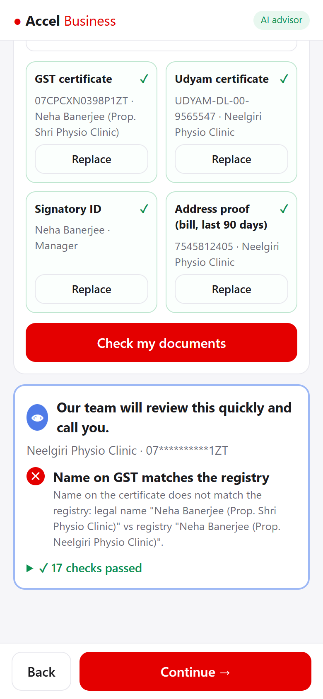
</p>

## Run it (judges: about 5 minutes)

Requirements: Python 3.11+, Node 18+, [Ollama](https://ollama.com).

```bash
ollama pull gemma3:4b                       # ~3.3 GB, one time (skip for rules-only demo mode)

cd frontend && npm install && npm run build && cd ..
python -m venv venv
venv\Scripts\activate          # macOS/Linux: source venv/bin/activate
pip install -r backend/requirements.txt
cd backend && python -m uvicorn app.main:app --port 8000   # serves API + UI
```

Open <http://localhost:8000>. Back-office: <http://localhost:8000/#/admin>.
`start.bat` (Windows) or `start.sh` (macOS/Linux) does all of this, creating and activating `venv` (project root) on first run.

- **No Ollama?** The app detects this and falls back to **Simple mode** (rules-based understanding, template explanations). Every screen still works; the badge top-right shows which mode you are in.
- **Data:** expects the case pack in `./data` (override with `DATA_DIR`). "Today" is fixed to 2026-07-15 as the pack requires (`DEMO_TODAY`).
- **Dev mode:** `npm run dev` in `frontend/` (port 5173, proxies `/api` to 8000).

### Try this in 3 minutes
1. Pick **हिन्दी**. Type: *मेरा पुणे में एक डेंटल क्लिनिक है, 12 लोग काम करते हैं। हमारे पास GST है।* The advisor fills in type, city, staff and GST in one go, then asks only what is missing. The first thing it asks is what troubles the business. Watch the pack card at the top fill up with each answer.
2. Or in English, tap **Shop** → pick **Internet keeps going down** + **Billing and UPI hassles** → Pune → 1–5 → Mobile hotspot → Neither → Under ₹2,000. You get ₹2,935/month (₹98 a day), a backup line because the internet drops, and a "you save ₹12,188 in year one" comparison.
3. On the plan screen, switch between **Basic / Recommended / Complete**, toggle an add-on, try 24 months. Price updates from the server. Locked add-ons say why (for example "needs a GST registration").
4. Accept → consent → pick a **sample applicant** (K01…K12) → *Check my documents*:
   - **K02** tilted photo → auto-straightened, passes
   - **K04** blurred → "retake"
   - **K05** missing Udyam certificate → "upload or type the number"
   - **K06** OCR misread the GSTIN → repaired by checksum + registry, asks you to confirm
   - **K07** name differs from registry → manual review (appears in the back-office hand-off queue)
   - **K01** GSTIN cancelled → GST-only products are removed, the rest can proceed
   - **K11** bill older than 90 days → "upload a recent bill"
5. Sign (the confirm page shows the offers applied), place the order, use **Demo: move to next step** on the tracker.
6. Open `#/admin` → *Live hand-offs* shows K07/K01 and any chat the advisor could not close.

## How it works

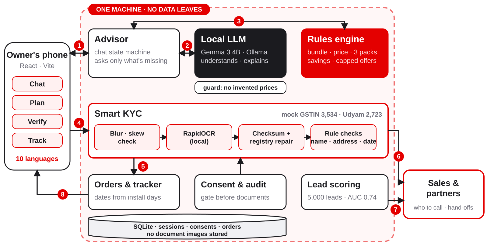

Numbers on the diagram: 1 owner chats · 2 local model turns free text into a profile · 3 code turns the profile into a bundle and price · 4 consent, then documents · 5 verdict creates the order · 6 cases needing a person go to the queue · 7 lead scores for sales and partners · 8 tracker returns to the owner.

**Principle: the LLM talks, code decides.** The model turns what the owner types into a structured profile and writes a friendly explanation. Eligibility, bundle, price and KYC verdicts are deterministic Python. If the model's explanation names a price or product that is not in the bundle, it is discarded for a template.

### Bundles are data-driven
Segment bundle shapes come from what 368 activated customers actually bought (`smb_leads.csv`): every professional office took cloud email; multi-site buyers took mobile lines, failover and SD-WAN; most micro shops took fibre 100 + postpaid 299. Prices sit inside the catalogue range (micro lower, 24-month contract lower again). Contract length is the longest minimum among chosen products.

### The plan sells, honestly (`backend/app/value.py`)
Biggest drop in the funnel is needs assessed → quote accepted (44%). Top lost reasons: price too high (414), locked in with current provider (325), cheaper competitor (207), decided to wait (107). The plan page answers each one:

| Owner thinks | What the page shows |
|---|---|
| "Is it worth it?" | Price, the same services bought separately (crossed out), and the price per day ("Just ₹98 a day") |
| "Which one do I pick?" | Basic / Recommended ("Most chosen") / Complete, one tap each |
| "Does it fix my problem?" | "You told us → here's the fix": each pain from the chat mapped to the line that solves it, or one tap to add it |
| "Why one pack?" | Year one cost, providers/bills/helplines and time to start, pack vs separately |
| "I'm locked in / I'll wait" | Switch with no downtime, price held 7 days, price locked, 30-day easy exit |
| "Will anyone help me?" | Help in their language, on-time install promise |

Honesty rules, all in code and tested (`tests/test_value.py`):
- "Separately" = the same items at the top of each product's own catalogue range, plus full setup. Never compared with what the owner pays today.
- If the owner pays less today (most micro shops do: median ₹900), the page says so: "Only about ₹48 a day more than you pay today, and you also get …".
- "Usual way" days (~13) and follow-up calls (~3) come from the lead data for that segment. Social proof counts are real activated customers; city counts show only when there are 5 or more.
- The two money offers (setup waived, first month half price) are capped at ₹5,000 each. They are a **proposal**, paid for by the gap between a field-sales customer (₹24,335) and a website customer (₹6,352).
- Pain points also change the plan: "internet keeps going down" adds a backup line.

### Smart KYC

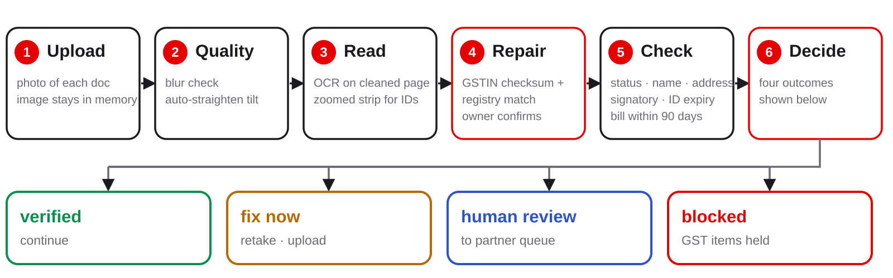

Binarise page (removes watermarks) → deskew from text-line angles → blur check (variance of Laplacian) → label-anchored row parsing → zoomed strip re-read for the monospaced GSTIN/Udyam IDs → **repair** misreads only when the result passes the GSTIN checksum *and* exists in the registry (always shown for confirmation) → rule checks (status, name, address, signatory authority, ID expiry, bill ≤ 90 days, same name on every document).
Verdicts: `verified`, `action_needed` (owner can fix now), `manual_review`, `blocked`. Review and blocked cases go to the human queue.

### Languages
Free-text chat works in Hindi, Tamil, Marathi, Telugu, Bengali, Gujarati, Kannada, Malayalam, Punjabi and English (plus Hinglish). UI and question strings: English and Hindi are hand-written; the others are translated once by the local model (`scripts/warm_i18n.py`) and cached in `backend/app/i18n_cache/`. **Machine translations need native-speaker review.**

## Screenshots

All captured from the running app by `backend/scripts/take_screenshots.py`.

**Advisor and plan (Hindi):** one sentence fills four answers, then the pain question

<p>
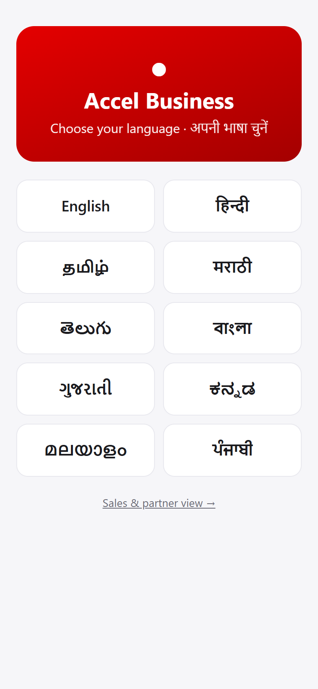 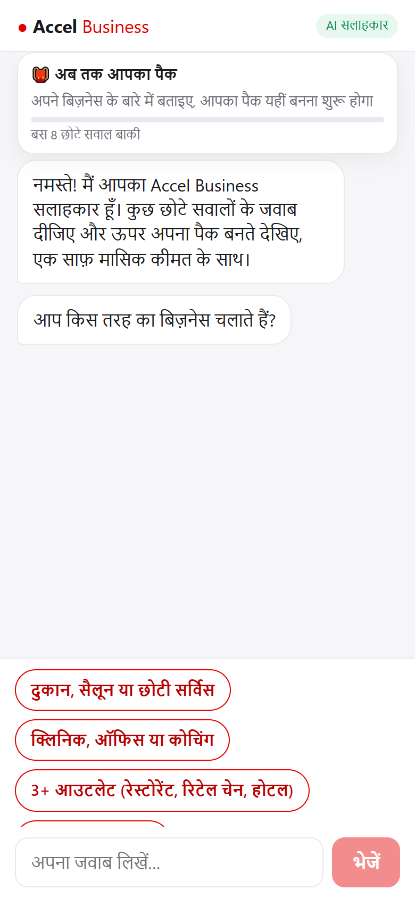 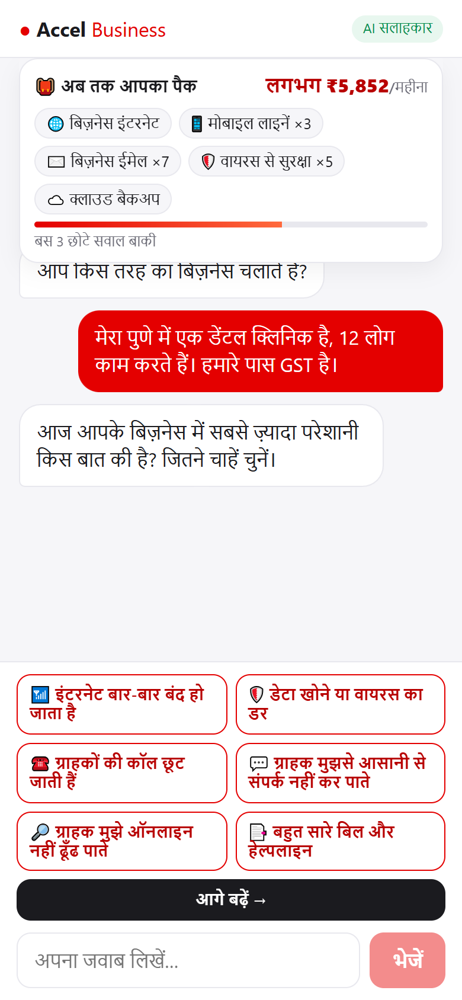 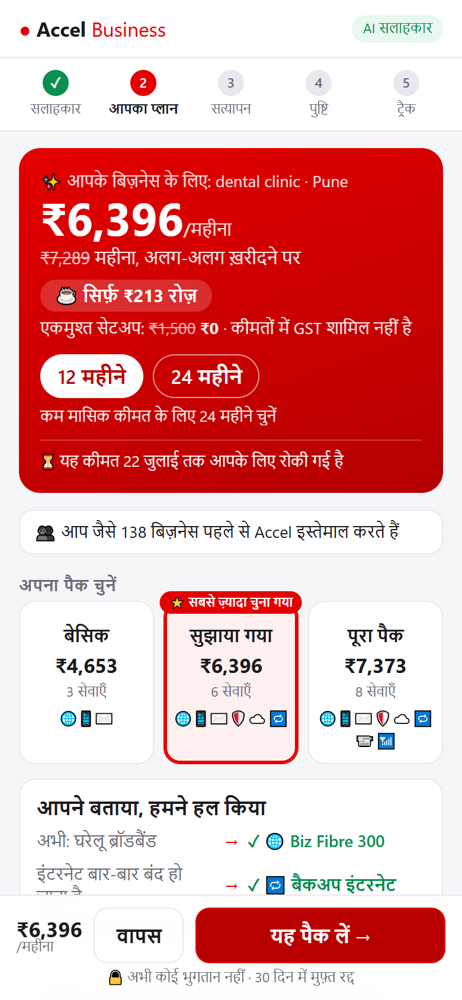
</p>

**Kirana in Pune (English):** pain chips, live pack, "building your plan", the plan page

<p>
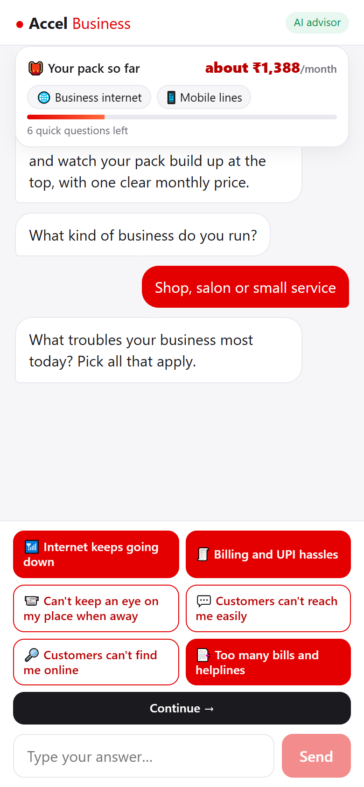  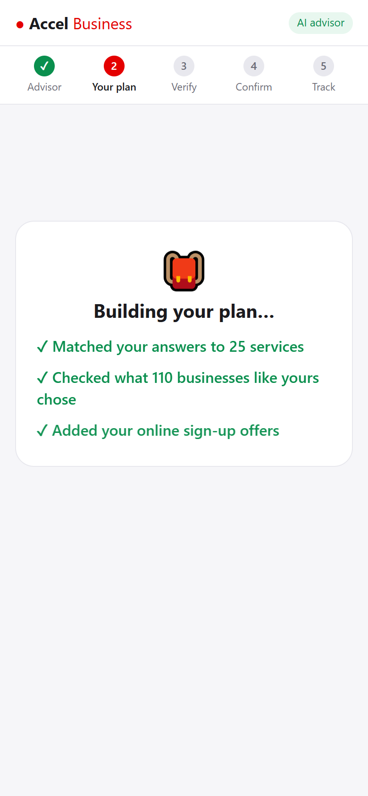 
</p>
<p>
 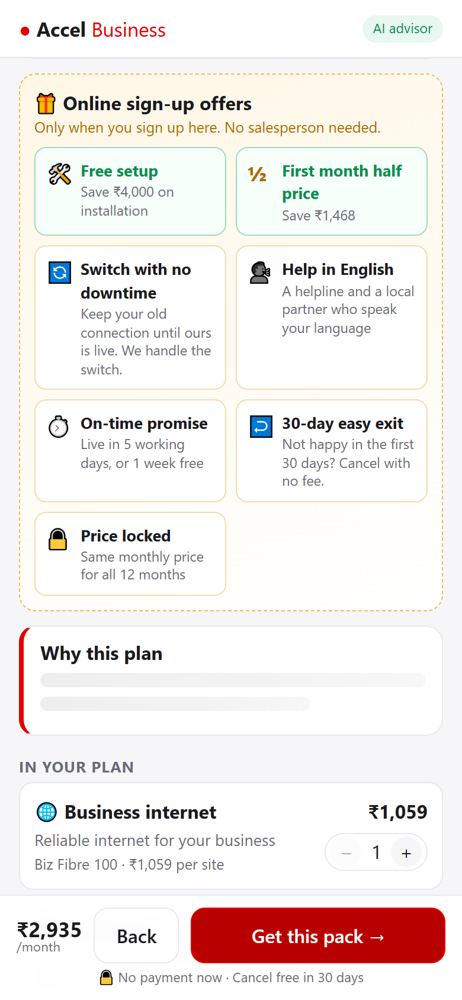
</p>

**Consent, sign (offers applied), tracker**

<p>
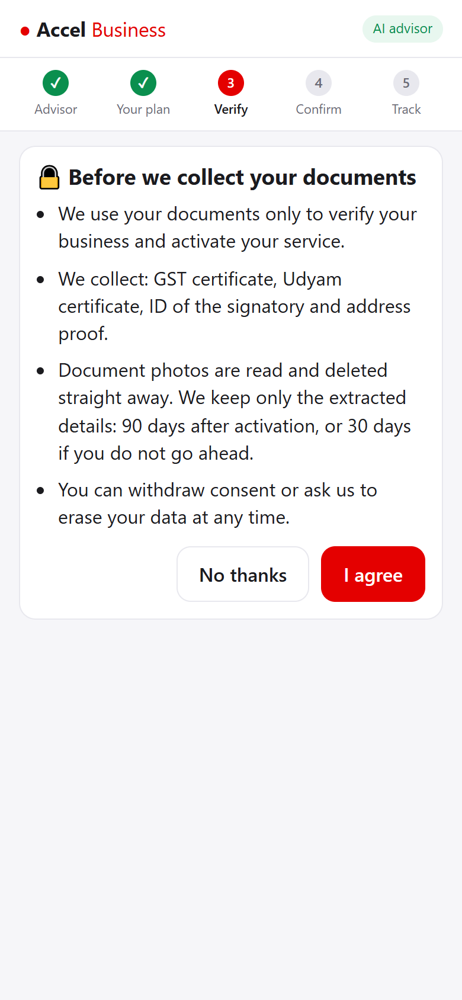 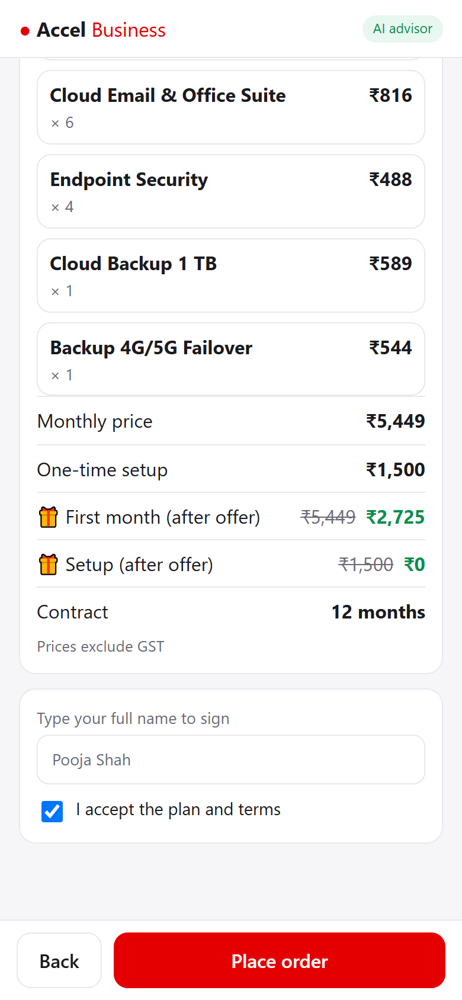 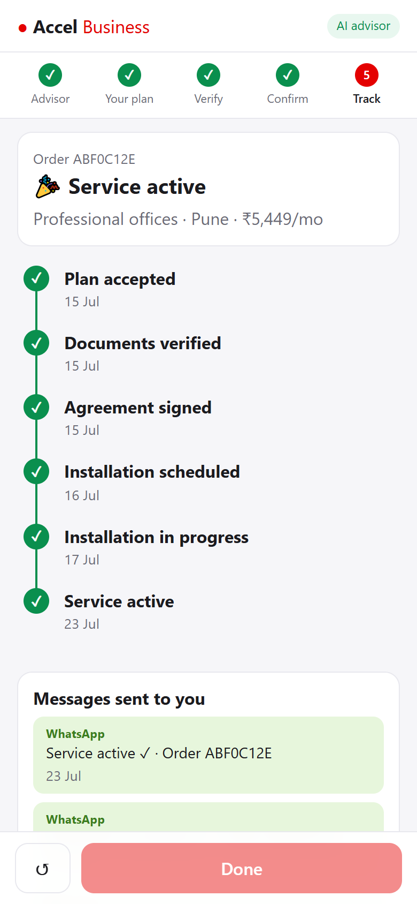
</p>

**Smart KYC: what it catches** (left to right: K06 documents + OCR repair, K06 verdict, K07 name mismatch, K04 blurred, K01 cancelled GSTIN, K11 stale bill)

<p>
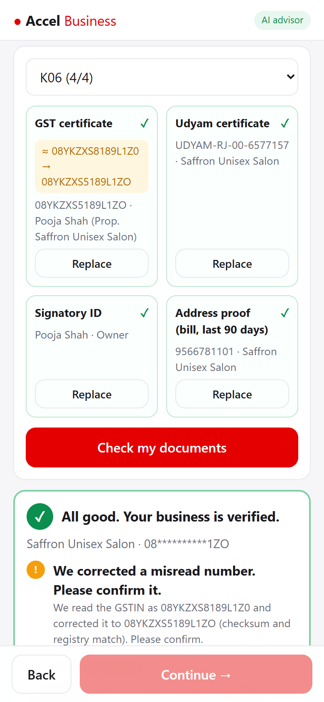 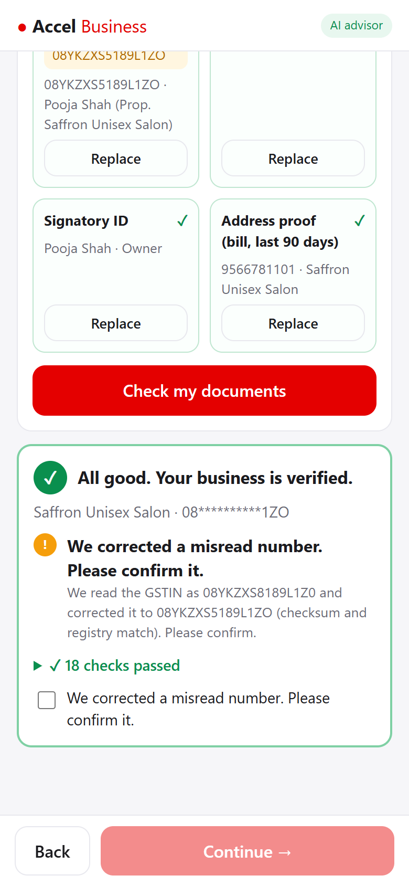  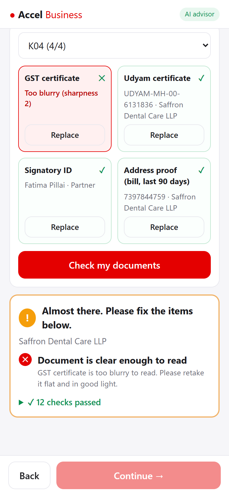 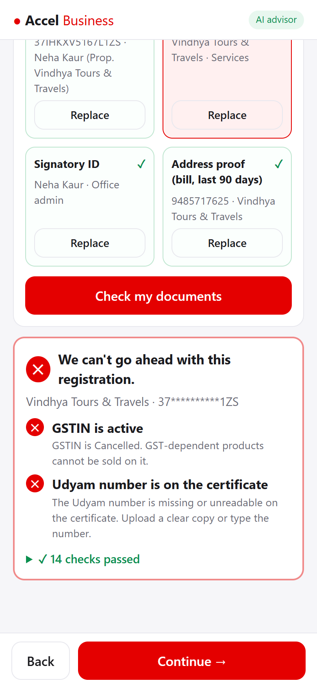 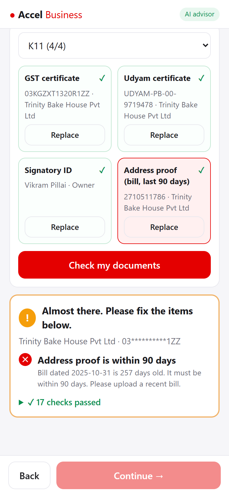
</p>

**Back office for sales and partners**

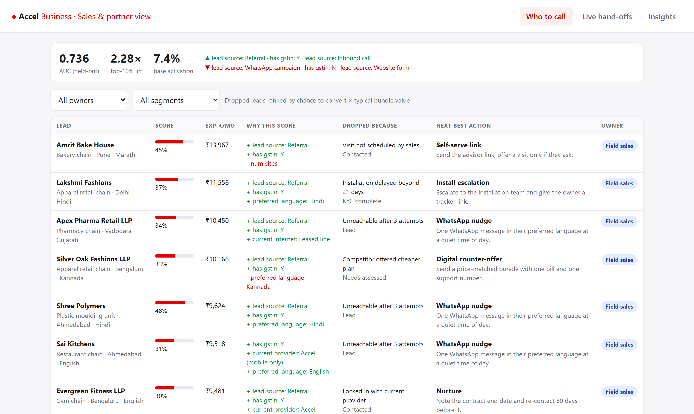
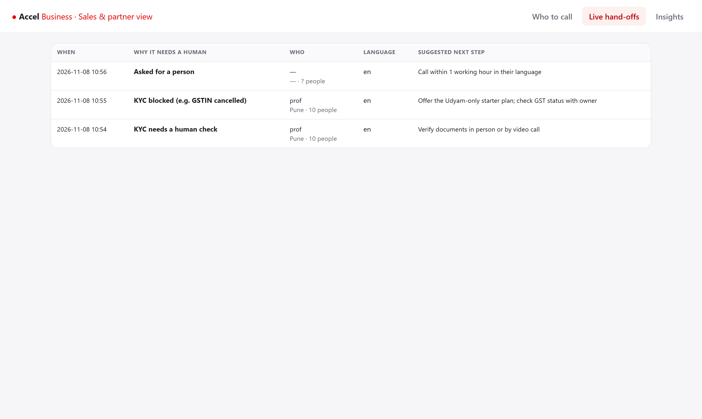
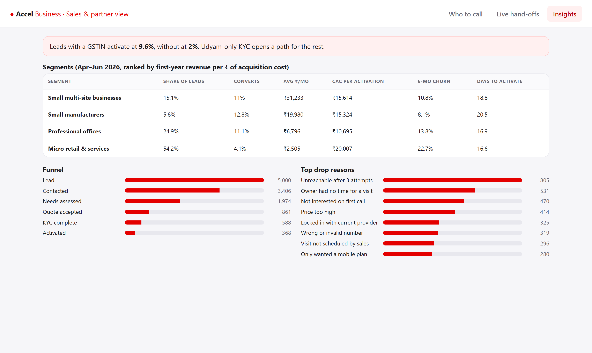

## Measured results (this repo, on a 4 GB GPU laptop)

| What | Result |
|---|---|
| Unit + API + regression tests | `cd backend && python -m pytest tests -q` → 39 passing |
| KYC on the 12 specimen applicants | 12/12 match expected verdicts (`python scripts/eval_kyc.py --cached`) |
| Vision LLM alone reading the GSTIN (Gemma 3 4B) | 4/12 exact at ~32 s/image, so it is not used as the primary reader. OCR + checksum/registry repair is |
| Lead model | AUC 0.74 held-out; top-decile lift 2.3× |
| Advisor free-text turn | 10-30 s on this laptop (model runs partly on CPU; first call after idle is slower). Chips answer instantly, no model call |
| Document OCR | ~4-8 s per document on CPU |

The 12/12 is against **our** reading of the specimens, not the judges' answer key.

## Known limitations
- Machine-translated strings (non-Hindi) are unreviewed.
- Blur threshold, skew correction and OCR are tuned on specimens; real phone photos need calibration. DigiLocker and e-sign are mocked (typed-name signature).
- Back-office has no authentication; SQLite is not encrypted. See [PRIVACY.md](PRIVACY.md).
- Voice/WhatsApp front end not built (stretch goal).
- Online offers (setup waiver, first month half price, on-time promise, 30-day exit, price hold) are proposals for Accel to approve, not existing policy.
- New plan-page text is hand-written in English and Hindi; other languages show it in English until `scripts/warm_i18n.py` is re-run.
- Prices inside the catalogue range follow our policy (micro 30%, professional 45%, others 50% of the range; 24 months −15 points), an assumption to validate.

## Layout
```
backend/app/        API, advisor, rules engine, value.py (tiers, comparison, offers), KYC, scoring
backend/tests/      39 tests (LLM off, throw-away DB)
backend/scripts/    eval_kyc.py, warm_i18n.py, parse_all.py
frontend/src/       React app (pages: Chat, Quote, Kyc, Confirm, Track, Admin)
docs/screenshots/   app screenshots (re-create with take_screenshots.py)
docs/figures/       architecture, KYC and journey diagrams (make_figures.py)
deck/              the SYNC submission deck (.pptx + .pdf) and its build script
demo_script.md     3-minute demo video script
data/               case pack (not modified)
```
